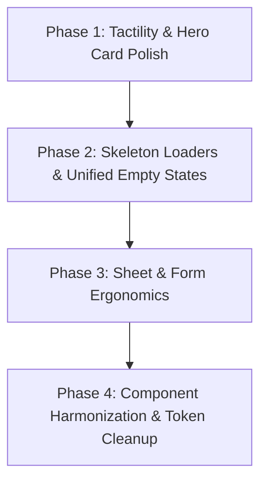

# Squad HQ — UI/UX Audit & Implementation Plan

This document contains the comprehensive UI/UX audit, problem diagnosis, design enhancement recommendations, and an actionable phased implementation plan for the **Squad HQ** Flutter application.

---

## 1. Executive Summary & Design System Status

**Squad HQ** uses the **Organic Design System**:
- **Palette**: Cream background (`#F5EAD8`), Ink (`#201E1D`), Terra-cotta Accent (`#C67139`), Olive Accent (`#7A8A5E`), and Team Gold (`#D9A13C`).
- **Dark Mode**: Midnight Pitch theme (`#121210`, `#1A1917`, `#23211E`) toggled via `ThemeController`.
- **Typography**: `Caprasimo` for display heroes (20px+); `Figtree` for titles, body, and labels.
- **Responsiveness**: `ResponsiveFrame` caps wide screens (tablets, desktop web) to `560px` centered.

### Foundational Status (What's Already Built vs Applied)
While several high-quality UI primitives were introduced in `lib/core/theme/widgets/`, their adoption across the app is currently fragmented:
- ✅ `BounceTap` is implemented with haptic feedback and spring curves, but is **0% adopted** across the app.
- ✅ `EdgeFade` is implemented, but used in only 2 files (`expense_sheet.dart`, `expenses_page.dart`), missing in chip rows like `notifications_page.dart`.
- ✅ `StickyActionSheet` is implemented, but missing in `trip_sheet.dart`, `confirm_payment_sheet.dart`, and `pay_bill_sheet.dart`.
- ✅ `Shimmer` & Skeletons exist for match cards, bills, and expense rows, but 25+ screens still show raw `CircularProgressIndicator`s.
- ✅ `EmptyState` with animated badge exists, but 6+ screens still use plain, unstyled text strings.

---

## 2. Problems Identified During UI/UX Audit

| # | Problem Area | Location / Impact | Root Cause & User Impact |
| :--- | :--- | :--- | :--- |
| **P1** | **Tactile & Motion Vacuum (`BounceTap` Unused)** | `MatchdayHeroCard`, `SquadCard`, `BillCard`, `HeroPillButton`, `SocialLoginButton` | `BounceTap` was created in `lib/core/theme/widgets/bounce_tap.dart` but is **not referenced anywhere in the app**. All buttons and cards feel flat and lifeless on press without tactile scale or haptic feedback. |
| **P2** | **Hero Card Visual Disconnect** | `MatchdayHeroCard` vs `DarkHeroCard` in `squad_widgets.dart` | `MatchdayHeroCard` uses a flat `BoxDecoration` with a hardcoded dark shadow `Color(0x292E2B25)`. It does not use `AppDecorations.darkHero()` or `AppShadows.darkHeroGlow`, making the primary Home tab centerpiece feel flat compared to the Squad tab's balance hero. |
| **P3** | **Loading State Chaos (25+ Raw Spinners)** | `team_membership_page.dart`, `team_roster_page.dart`, `match_history_page.dart`, `past_match_page.dart`, `notifications_page.dart`, `invitations_page.dart`, `invite_people_sheet.dart`, `player_card_page.dart` | Users experience layout jumps and jarring spinner flashes because `CircularProgressIndicator` is centered instead of using skeleton placeholders. Missing skeletons for roster rows, notifications, and invitations. |
| **P4** | **Fragmented & Bare Empty States** | `invitations_page.dart`, `notifications_page.dart`, `match_history_page.dart`, `wallet_bills_page.dart`, `trip_page.dart`, `settle_page.dart` | Despite having a rich `EmptyState` component with animated badges and action CTAs, screens use plain centered text (e.g. `_Message('No invitations right now.')`, `Text('No bills yet.')`, `_AllSquare`). |
| **P5** | **Bottom Sheet Usability & Keyboard Clipping** | `trip_sheet.dart`, `confirm_payment_sheet.dart`, `team_switcher_sheet.dart`, `timezone_picker_sheet.dart` | • `trip_sheet.dart`: In squads with 10+ members, users must scroll through all member checkboxes to find the "Create trip" button. • `confirm_payment_sheet.dart`: Entering a partial amount causes the keyboard to cover the Confirm button. • `team_switcher_sheet.dart`: `isScrollControlled: false` risks bottom overflow on compact devices. |
| **P6** | **Duplicate Expand/Collapse Lists Without Motion** | `_UnbilledList` in `wallet_page.dart` | Re-implements show more/less without `AnimatedSize`, causing jarring layout jumps when toggled (unlike `SeeMoreList` in `squad_widgets.dart`). |
| **P7** | **Missing Horizontal Scroll Cues** | `_FilterRow` in `notifications_page.dart`, category chips | Horizontal scroll rows lack `EdgeFade`, cutting off chips abruptly with no visual cue that more options exist offscreen. |
| **P8** | **Token Deviations & Hardcoded Opacities** | Throughout `profile_page.dart`, `match_page.dart`, `login_page.dart`, `squad_widgets.dart` | Over 50 call-sites use ad-hoc opacities like `.withValues(alpha: 0.1)`, `0.16`, `0.18`, `0.7` or hardcoded hex colors (`0xFFE4DBCD`, `0x47F9F4ED`) instead of tokens (`AppColors.divider`, `AppColors.onDarkMuted`, `AppColors.textMuted`). |
| **P9** | **Fixed-Height Input Clipping** | `_Field` in `create_match_sheet.dart` | Wrapping text fields in `SizedBox(height: 50)` clips text ascenders and descenders when system text scaling factor exceeds 1.0 (accessibility issue). |
| **P10** | **Redundant Container & Material Nesting** | `ProfilePage`, `SquadCard` | Redundant nesting of `Material(borderRadius: ...)` enclosing `Container(decoration: BoxDecoration(borderRadius: ...))`, causing unnecessary render objects and border clipping artifacts. |

---

## 3. UI/UX Improvement Recommendations

### A. Tactility & Micro-Interactions
1. **Adopt `BounceTap` on Key CTAs & Interactive Cards**:
   - Wrap primary buttons (`SquadPrimaryButton`, `HeroPillButton`, `_PillButton` in `MatchdayHeroCard`, `SocialLoginButton`).
   - Wrap major tap targets (`BillCard`, `SquadCard`, `_InviteCard`, `_NotificationTile`).
   - Ensures consistent `0.98` scale down on press with `HapticFeedback.lightImpact()` and accessibility respect (`MediaQuery.disableAnimationsOf`).
2. **Elevate Matchday Hero**:
   - Apply `AppDecorations.darkHero()` to `MatchdayHeroCard` to add warm radial glow and ambient depth.
   - Animate RSVP selection changes with smooth background transitions.

### B. Perceived Performance & Skeletons
1. **Standardize Skeleton Placeholders**:
   - Add `NotificationRowSkeleton` for `notifications_page.dart`.
   - Add `InviteCardSkeleton` for `invitations_page.dart`.
   - Add `MemberRowSkeleton` for `team_roster_page.dart` and `squad_members_page.dart`.
   - Replace raw centered `CircularProgressIndicator`s across all top-level pages.

### C. Cohesive Empty States
1. **Unify All Empty States**:
   - Replace bare text in `invitations_page.dart` with `EmptyState(icon: Icons.mail_outline_rounded, title: 'No pending invites', ...)`.
   - Upgrade `notifications_page.dart` empty view to `EmptyState`.
   - Upgrade `match_history_page.dart` and `wallet_bills_page.dart` empty views.
   - Modernize `_AllSquare` on `settle_page.dart` using the unified badge design.

### D. Sheet Usability & Form Ergonomics
1. **Migrate Remaining Forms to `StickyActionSheet`**:
   - Refactor `trip_sheet.dart` to pin "Create trip" / "Save changes" at the bottom with keyboard safety.
   - Refactor `confirm_payment_sheet.dart` to pin action buttons above keyboard in partial payment mode.
2. **Standardize Sheet Properties**:
   - Use `AppRadius.sheet` uniformly across all sheets (`invite_people_sheet.dart`, etc.).
   - Ensure `isScrollControlled: true` on `team_switcher_sheet.dart` to eliminate layout overflow risks.

### E. List Animation & Scroll Ergonomics
1. **Harmonize Expandable Lists**:
   - Replace custom `_UnbilledList` in `wallet_page.dart` with `SeeMoreList` so expansions are animated smoothly.
2. **Edge Fades**:
   - Wrap `_FilterRow` in `notifications_page.dart` with `EdgeFade`.

---

## 4. Phased Implementation Plan

### Phase 1: Tactility & Hero Card Polish (Completed)
- [x] **Elevate `MatchdayHeroCard`**:
  - Update `lib/features/team/presentation/widgets/matchday_hero_card.dart` to use `AppDecorations.darkHero()`.
  - Wrap `_PillButton` with `BounceTap`.
  - Add `HapticFeedback.selectionClick()` on RSVP taps.
- [x] **Adopt `BounceTap` on Primary Buttons**:
  - Integrate `BounceTap` into `HeroPillButton` and `SquadPrimaryButton` in `lib/features/squad/presentation/widgets/squad_widgets.dart`.
  - Integrate `BounceTap` into `SocialLoginButton` in `lib/features/auth/presentation/widgets/social_login_button.dart`.
  - Wrap `BillCard` and `SquadCard` tap targets with `BounceTap`.

### Phase 2: Skeleton Loaders & Unified Empty States (Completed)
- [x] **Create Missing Skeletons** in `lib/core/theme/widgets/skeletons.dart`:
  - `NotificationRowSkeleton`
  - `InviteCardSkeleton`
  - `MemberRowSkeleton`
- [x] **Replace Spinners with Skeletons**:
  - `lib/features/notifications/presentation/pages/notifications_page.dart`
  - `lib/features/invites/presentation/pages/invitations_page.dart`
  - `lib/features/team_membership/presentation/pages/team_roster_page.dart`
  - `lib/features/team_membership/presentation/pages/team_membership_page.dart`
  - `lib/features/match/presentation/pages/match_history_page.dart`
  - `lib/features/match/presentation/pages/past_match_page.dart`
- [x] **Unify Empty States using `EmptyState`**:
  - `invitations_page.dart`
  - `notifications_page.dart`
  - `match_history_page.dart`
  - `wallet_bills_page.dart`
  - `trip_page.dart`

### Phase 3: Sheet & Form Ergonomics (Completed)
- [x] **Migrate `trip_sheet.dart` to `StickyActionSheet`**:
  - Pinned "Create trip" button with member checkboxes in scrolling body.
- [x] **Modernize `confirm_payment_sheet.dart`**:
  - Pinned action buttons with keyboard inset protection when entering partial amounts.
- [x] **Fix Sheet Consistency & Overflow**:
  - Set `isScrollControlled: true` on `showTeamSwitcherSheet`.
  - Standardize `AppRadius.sheet` in `invite_people_sheet.dart`.
  - Fix `_Field` fixed height constraint in `create_match_sheet.dart` for dynamic type support.

### Phase 4: Component Harmonization & Token Cleanup
- [ ] **Harmonize Expandable Lists**:
  - Refactor `_UnbilledList` in `wallet_page.dart` to use `SeeMoreList(curve: Curves.easeInOutCubic)`.
- [ ] **Edge Fades**:
  - Wrap notification filter chips in `EdgeFade`.
- [ ] **Token Cleanup**:
  - Replace ad-hoc `.withValues(alpha: ...)` border colors with `AppColors.divider`.
  - Clean up redundant `Material` / `Container` nesting in `ProfilePage`.

---

## 5. Verification & Testing Checklist

- [ ] Run `dart analyze` — ensure zero warnings or errors.
- [ ] Run `flutter test` — ensure all 238 unit and widget tests pass with zero regressions.
- [ ] Verify light & dark theme rendering across all modified screens.
- [ ] Verify keyboard interaction in sheets (no overflow or obscured action buttons).
- [ ] Verify `BounceTap` respects `MediaQuery.disableAnimationsOf`.
