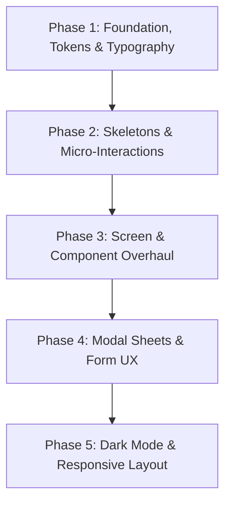

# Squad HQ — UI/UX Audit & Implementation Plan

This document contains the complete UI/UX review, design enhancement recommendations, and a phased implementation plan for the **Squad HQ** Flutter application.

---

## 1. Executive Summary & Project Context

**Squad HQ** is a Flutter cross-platform mobile/web application serving amateur football teams and social groups/squads.
The application currently features:
- **Football Team Hub**: Dashboard, Next Match preview, matchday RSVP poll (In/Out/Maybe), match bills, roster, comments, match history.
- **Squad / Group Hub**: Overall balance overview, expense tracking, trip-specific expenses, monthly subscriptions, and debt settlement workflows.
- **Design System ("Organic")**: Cream background (`#F5EAD8`), Ink (`#201E1D`), Terra-cotta Accent (`#C67139`), Olive Accent 2 (`#7A8A5E`), and Team Gold (`#D9A13C`). Headings use `Caprasimo` and body/labels use `Figtree`.

---

## 2. UI/UX Audit & Gap Analysis

| Category | Current Implementation | Identified Areas for Improvement |
| :--- | :--- | :--- |
| **Visual Hierarchy & Depth** | Flat cards with hairline borders (`alpha: 0.10`). Standard box layouts. | • Cards lack depth and tactile hierarchy. • Introduce soft multi-layer ambient shadows. • Add subtle gradient glow to dark hero cards and primary CTAs. |
| **Typography & Readability** | `Caprasimo` for all headings; `Figtree` for body and labels. | • `Caprasimo` used at small sizes (<15px) causes readability issues due to chunky serifs. • Reserve `Caprasimo` for hero titles (20px+) and use `Figtree (w700/w800)` for mid-size card headers. |
| **Accessibility & Contrast** | Text colors using low opacity (`alpha: 0.40–0.45`) on cream backgrounds. | • Muted captions risk failing WCAG AA (4.5:1 ratio). • Standardize on explicit contrast tokens (`neutral700`, `neutral800`). |
| **Motion & Feedback** | Standard Material ripple; abrupt expand/collapse in `SeeMoreList`. | • Missing spring scale animations on cards/buttons. • Add `AnimatedSize` / `AnimatedCrossFade` for list expansions. • Add `HapticFeedback` on RSVPs, role toggles, and payment confirmations. |
| **State Feedback & Loaders** | Centered `CircularProgressIndicator` across all screens. | • Causes layout jumps when data loads. • Replace with customized **Skeleton/Shimmer loaders** mirroring the actual component layout. |
| **Empty States** | Text-heavy with basic circular icon containers. | • Create visually rich empty state cards with clear next steps and guidance. |
| **Bottom Sheets & Forms** | Standard modal sheets with scrolling content. | • Add sticky bottom CTA bars with subtle gradient fade to ensure action buttons are always reachable during input. |
| **Responsive & Multiplatform** | Expands full-width on web/tablet without max-width constraints. | • Wrap views in a responsive container (`kMaxContentWidth = 560px`) for optimal readability on tablet/desktop. |
| **Themes** | Only Light mode supported. | • Add a Dark Mode / Midnight Pitch theme (`#121210`, `#1A1917`). |

---

## 3. Key UI/UX Improvement Recommendations

### A. Design Tokens & Theme Polish
1. **Typography Scaling**:
   - `Hero Heading (24–38px)`: `GoogleFonts.caprasimo`
   - `Section & Card Heading (14–18px)`: `GoogleFonts.figtree(fontWeight: FontWeight.w700)`
   - `Body (13–15px)`: `GoogleFonts.figtree(fontWeight: FontWeight.w500)`
   - `Label / Badges (10–12px)`: `GoogleFonts.figtree(fontWeight: FontWeight.w700, letterSpacing: 0.5)`
2. **Elevation & Shadows**:
   - Standardize `AppShadows.subtle`, `AppShadows.elevatedCard`, and `AppShadows.darkHeroGlow`.

### B. Micro-Interactions & Tactile Polish
1. **`TactileCard` / `BouncingButton`**: Reusable interactive wrapper providing a subtle `0.98` scale down on press with light haptic feedback.
2. **RSVP Poll Buttons**: Animate button selection with smooth background transitions and checkmark state icons.
3. **Smooth Accordions**: Replace abrupt list toggles in `SeeMoreList` with `AnimatedSize(curve: Curves.easeInOutCubic)`.

### C. Skeleton Loaders (Perceived Performance)
1. **`MatchCardSkeleton`**: Placeholder for upcoming match card with shimmering score/time boxes.
2. **`BillCardSkeleton` & `ExpenseRowSkeleton`**: Placeholder rows for wallet and squad expenses.
3. **`ShimmerContainer`**: Reusable linear gradient shimmer effect.

### D. Sheet & Modal Usability
1. **Sticky Action Scrim**: Form sheets with sticky bottom buttons over a soft gradient blur so the primary action is never lost under long content.
2. **Category Chip Gradients**: Horizontal scrolling chips with soft edge fade indicators.

---

## 4. Phased Implementation Plan

### Phase 1: Foundation, Design Tokens & Typography
- [ ] Audit and update `lib/core/theme/app_text_styles.dart` to separate display vs card headings.
- [ ] Update `lib/core/theme/app_colors.dart` to ensure high contrast for all muted text.
- [ ] Add shadow tokens and border radius constants in `lib/core/theme/app_theme.dart`.

### Phase 2: Skeletons, Animations & Tactile Primitives
- [ ] Create `lib/core/theme/widgets/shimmer_effect.dart`.
- [ ] Create skeleton widgets:
  - `MatchCardSkeleton`
  - `BillCardSkeleton`
  - `ExpenseRowSkeleton`
- [ ] Create `TactileFeedback` / `BounceTap` widget with `HapticFeedback.lightImpact()`.
- [ ] Update `SeeMoreList` in `squad_widgets.dart` to use `AnimatedSize`.

### Phase 3: Screen & Component Overhaul
- [ ] **Dashboard & Match Hub**:
  - Elevate `MatchdayHeroCard` with animated RSVP feedback, status chips, and manager controls.
  - Redesign `_EmptyHome` and `_EmptyMatchday` with modern illustrated empty states.
- [ ] **Squad & Expenses Hub**:
  - Enhance `_BalanceHero` / `DarkHeroCard` with subtle radial gradient highlight.
  - Add category color badges for `ExpenseRow`.
  - Add horizontal fade shader for category filter chips.
- [ ] **Wallet Hub**:
  - Add payment progress bars to `BillCard` (`X of Y paid`).

### Phase 4: Modal Sheets & Forms UX
- [ ] Modernize `CreateMatchSheet`, `ExpenseSheet`, `BillSheet`, and `PaySheet`.
- [ ] Implement sticky bottom action button layouts with keyboard padding.
- [ ] Add monetary input formatting with instant split previews.

### Phase 5: Dark Mode & Responsive Layout
- [ ] Implement `AppTheme.dark` (Midnight pitch theme).
- [ ] Create `ResponsiveContainer` / `ConstrainedScaffold` with max content width for tablets & web.

---

## 5. Quick Reference Files

- App Entry & Routes: [lib/core/routing/app_router.dart](file:///Users/thawzinoo/squad_hq/lib/core/routing/app_router.dart)
- Theme & Styles: [lib/core/theme/app_theme.dart](file:///Users/thawzinoo/squad_hq/lib/core/theme/app_theme.dart), [lib/core/theme/app_colors.dart](file:///Users/thawzinoo/squad_hq/lib/core/theme/app_colors.dart), [lib/core/theme/app_text_styles.dart](file:///Users/thawzinoo/squad_hq/lib/core/theme/app_text_styles.dart)
- App Shell & Navigation: [lib/features/team/presentation/pages/app_shell_page.dart](file:///Users/thawzinoo/squad_hq/lib/features/team/presentation/pages/app_shell_page.dart)
- Home & Match Pages: [lib/features/team/presentation/pages/dashboard_page.dart](file:///Users/thawzinoo/squad_hq/lib/features/team/presentation/pages/dashboard_page.dart), [lib/features/team/presentation/pages/match_page.dart](file:///Users/thawzinoo/squad_hq/lib/features/team/presentation/pages/match_page.dart)
- Squad & Expenses Pages: [lib/features/squad/presentation/pages/squad_home_page.dart](file:///Users/thawzinoo/squad_hq/lib/features/squad/presentation/pages/squad_home_page.dart), [lib/features/squad/presentation/pages/expenses_page.dart](file:///Users/thawzinoo/squad_hq/lib/features/squad/presentation/pages/expenses_page.dart)
- Wallet Page: [lib/features/team/presentation/pages/wallet_page.dart](file:///Users/thawzinoo/squad_hq/lib/features/team/presentation/pages/wallet_page.dart)
